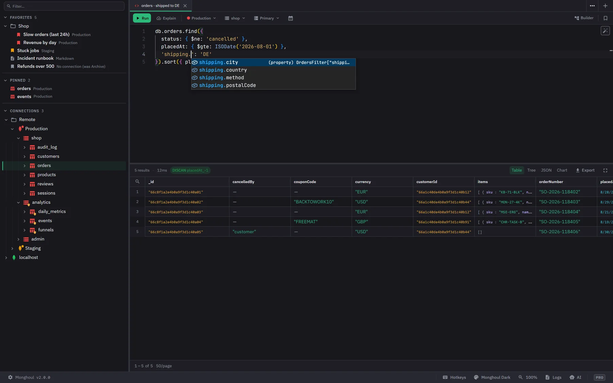
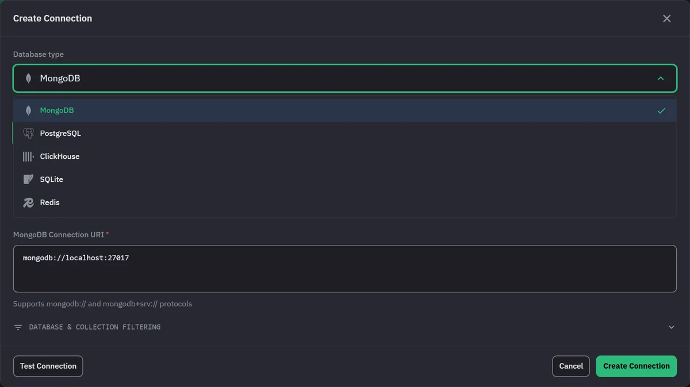
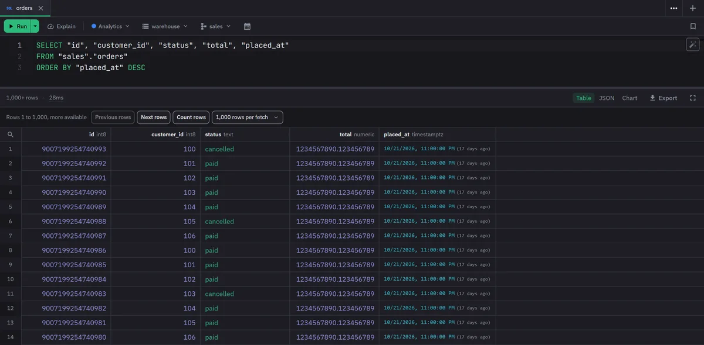
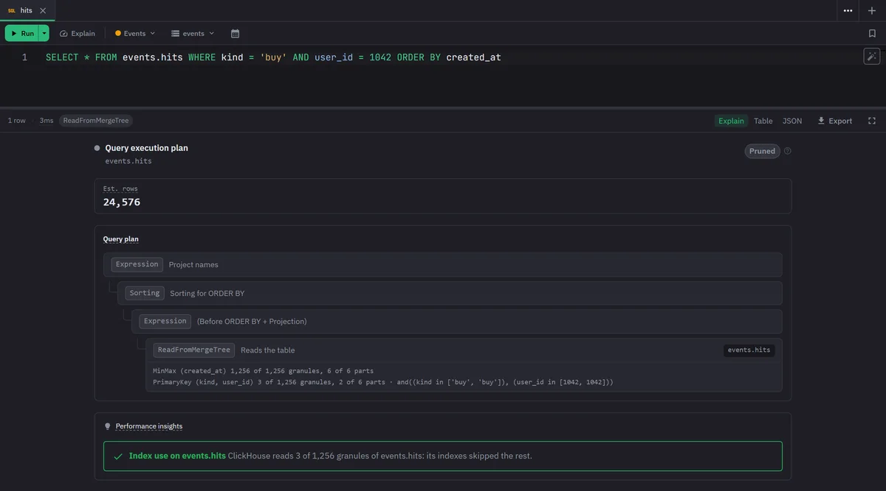
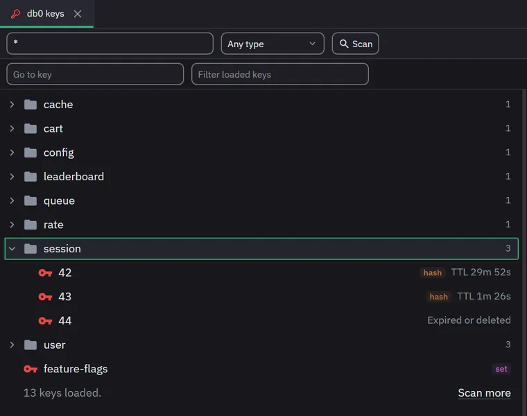

  

<h1 align="center">Monghoul</h1>

  A desktop IDE for MongoDB, PostgreSQL, ClickHouse, SQLite, and Redis with Valkey.

  <a href="https://monghoul.com">Website</a> ·
  <a href="https://monghoul.com/databases/">Databases</a> ·
  <a href="https://monghoul.com/product/">Product</a> ·
  <a href="https://monghoul.com/docs/">Docs</a> ·
  <a href="https://monghoul.com/download/">Download</a> ·
  <a href="https://monghoul.com/pricing/">Pricing</a> ·
  <a href="https://monghoul.com/releases/">Changelog</a>

  
  
  
  
  

---

## What this repository is

This is where Monghoul is **released** and where its **issues** are tracked. The application source
is not here.

- [Releases](https://github.com/Kontsedal/monghoul-public/releases): every version, with installers
  for all three platforms
- [Issues](https://github.com/Kontsedal/monghoul-public/issues): bug reports and feature requests

## What is Monghoul?

A desktop database IDE built with [Tauri](https://tauri.app) and [Bun](https://bun.sh). It started
as a MongoDB IDE, and since 2.0 it opens PostgreSQL, ClickHouse, SQLite, and Redis with Valkey in
the same window, the same sidebar and the same editor. It uses the web view your operating system
already ships instead of bundling a browser, so the Windows installer is about 43 MB.

Your data stays on your machine. Connections, saved passwords, queries, tabs and logs live on your
computer, saved passwords are encrypted with a key held by your system's credential store, and
there is no account to create.

[What 2.0 adds, engine by engine](https://monghoul.com/blog/monghoul-2-0/)

## Five engines, one window

  

| Engine | What it gets |
|---|---|
| **MongoDB** | Autocomplete from the field names and values in your collections, the visual aggregation builder, Explain with the index a query needs, and the Database Map. [More](https://monghoul.com/databases/mongodb/) |
| **PostgreSQL** | SQL drafts with completion from your schemas and joins from your foreign keys, Explain with real rows and times, grid edits reviewed and applied in one transaction, and Manual commit. [More](https://monghoul.com/databases/postgresql/) |
| **ClickHouse** | Explain that counts the granules a read selects, drafts with `{name:Type}` parameters, and grid edits by sorting key, where a mutation asks first because ClickHouse cannot undo it. [More](https://monghoul.com/databases/clickhouse/) |
| **SQLite** | A `.db`, `.sqlite` or `.sqlite3` file opens with no server, and every value shows exactly as SQLite stored it. [More](https://monghoul.com/databases/sqlite/) |
| **Redis and Valkey** | A key browser on SCAN, an editor for each key type that checks your values before it writes, and a console that asks before a command can delete data. [More](https://monghoul.com/databases/redis/) |

<table>
  <tr>
    <td width="50%"></td>
    <td width="50%"></td>
  </tr>
  <tr>
    <td align="center">PostgreSQL: a draft and its result</td>
    <td align="center">ClickHouse: Explain counts the granules a read selects</td>
  </tr>
</table>

  
   
  Redis and Valkey: the key browser, grouped by prefix

## Highlights

- **The same tools on every engine**: write protection, operation logs, import, export, the Database
  Map and AI access work on all five, wherever the engine has what a tool reads
- **Writes that ask first**: a SQL statement that can drop data or change every row names its
  reasons before it runs, and a Redis command that can delete data shows the exact command
- **Schema-aware autocomplete** that follows MongoDB fields through `$lookup`, `$group`, `$project`,
  `$facet` and the rest, so a joined field completes eight lines later
- **Visual aggregation builder** with a per-stage preview, a `$lookup` form helper, and code that
  stays in sync with the visual pipeline
- **Charts**: bar, horizontal bar, line, pie, scatter and area, with stacking, dual axis, date
  aggregation and PNG export
- **Cluster Monitor** for MongoDB, PostgreSQL, ClickHouse and Redis, with live metrics, a health
  panel and the slow queries of each engine
- **70+ MCP tools** for AI assistants (Claude, Cursor, Windsurf, and any MCP client), behind a
  permission model and an approval that holds exactly the query you saw
- **Eleven built-in themes** and an editor that derives a whole token set from three colours
- **SSH tunnels** with a host key check, and TLS with custom certificates, on every engine that has
  a server
- **Write protection**, per connection and narrowable to particular databases and collections,
  enforced at the driver rather than by reading your query

[The product pages](https://monghoul.com/product/) walk through these by workflow.
[The documentation](https://monghoul.com/docs/) is the manual.

## Download

| Platform | Format | Install notes |
|---|---|---|
| Windows | `.exe` installer, `.msi` for deployment, or `winget install Monghoul.Monghoul` | [Windows](https://monghoul.com/download/windows/) |
| macOS | `.dmg` for Apple silicon and Intel, signed and notarized | [macOS](https://monghoul.com/download/mac/) |
| Linux | `.AppImage`, `.deb` or `.rpm` | [Linux](https://monghoul.com/download/linux/) |

The Linux `.AppImage` runs on any distribution, and it is the only Linux format the in-app updater
can replace. A `.deb` or `.rpm` install updates through your package manager instead.

**[Download the latest release](https://github.com/Kontsedal/monghoul-public/releases/latest)**, or
see [monghoul.com/download](https://monghoul.com/download/) for the installers and the size of each.

**Server versions.** MongoDB 4.4 or newer: Monghoul refuses an older server with an explicit error
rather than failing in unclear ways later. Redis 6.2 or newer, or Valkey. For PostgreSQL and
ClickHouse, Test Connection names the server's version, and SQLite opens a file with no server. See
[system requirements](https://monghoul.com/system-requirements/).

**Coming from 1.x?** The first 2.0 launch copies your data into a new file and never changes the
old one, so 1.14 can still open it. AI assistants use version 2 of the MCP tools; the
[migration guide](https://monghoul.com/docs/reference/mcp-2-migration/) maps each 1.x tool name.

## Free and Pro

The free tier is not a trial. It does not expire, it needs no card, and it includes every engine.

| | Free | Pro |
|---|---|---|
| Engines | All five | All five |
| Saved connections | 8, across all engines | Unlimited |
| Favorite queries | 5 | Unlimited |
| Pinned collections | 5 | Unlimited |
| Open tabs | No limit | No limit |
| Multi-panel layout, sidebar folders | ✓ | ✓ |
| Query editor, autocomplete, aggregation builder | ✓ | ✓ |
| SQL drafts, Explain, grid edits, Redis key editors | ✓ | ✓ |
| Tree, table and JSON views | ✓ | ✓ |
| Schema analysis | 500 sampled docs | Unlimited |
| Generated test documents | 500 | 100,000 |
| Operation log entries | 250 | Unlimited |
| MongoDB authentication | No auth, user and password, SCRAM | Plus X.509, LDAP, Kerberos, AWS IAM |
| Charts and visualization | — | ✓ |
| Cluster Monitor | — | ✓ |
| AI access, the MCP server | — | ✓ |
| Document diff | — | ✓ |
| Custom themes | — | ✓ |
| Detached windows | — | ✓ |
| Excel import and export | — | ✓ |
| Cross-instance collection copy | — | ✓ |
| Database-level export and import | — | ✓ |

Pro is one $59 lifetime license, with every update included. Every eligible device also gets a
**14-day Pro trial, once**, with no email address and no card. Full details on
[the pricing page](https://monghoul.com/pricing/) and in
[Free and Pro](https://monghoul.com/docs/concepts/free-and-pro/).

## Reporting a bug or asking for a feature

[Open an issue](https://github.com/Kontsedal/monghoul-public/issues/new/choose). The forms ask for
what is needed to reproduce a problem, so filling one in beats a blank issue.

- **Bugs**: the app version, your OS, the database engine, and the steps that produce it. The
  Operation Logs panel often holds the server's own message, which is the useful part.
- **Features**: describe the problem you are trying to solve rather than the solution you have in
  mind. It leaves room for a better answer.

For anything security related, see [SECURITY.md](SECURITY.md). Please do not open a public issue
for a vulnerability.

## Free browser tools

No install, nothing uploaded, and they run entirely in the page:

[Explain plan visualizer](https://monghoul.com/explain-visualizer/) ·
[SQL to MongoDB](https://monghoul.com/sql-to-mongodb/) ·
[Extended JSON converter](https://monghoul.com/ejson-converter/) ·
[ObjectId decoder](https://monghoul.com/objectid-decoder/) ·
[Connection string parser](https://monghoul.com/connection-string-parser/) ·
[BSON size calculator](https://monghoul.com/bson-size-calculator/) ·
[Aggregation cheat sheet](https://monghoul.com/aggregation-cheat-sheet/)

## Links

[Website](https://monghoul.com) ·
[Databases](https://monghoul.com/databases/) ·
[Documentation](https://monghoul.com/docs/) ·
[Changelog](https://monghoul.com/releases/) ·
[Support](https://monghoul.com/support/) ·
[Privacy](https://monghoul.com/privacy/) ·
[Terms](https://monghoul.com/terms/) ·
[EULA](https://monghoul.com/eula/)
